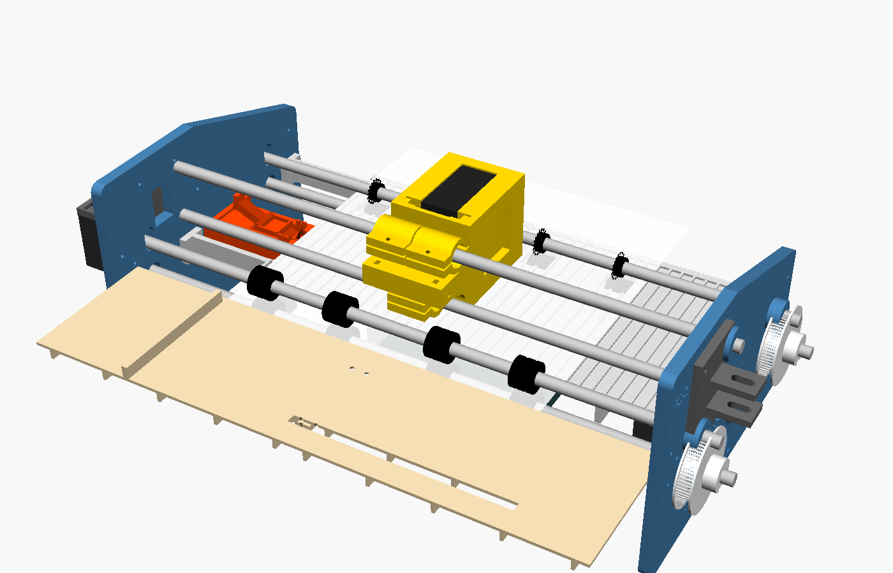

# FreeJet FJ-1: an open DIY inkjet printer

A paper printer you print and build yourself: 3D-printed frame, standard
HP 45 ink cartridge (refillable, no DRM chip games), a $5 Raspberry Pi
Pico 2 for brains, and its own driver over USB. Inspired by
[Openprinter](https://www.crowdsupply.com/open-tools/openprinter) (Open Tools),
which is still "launching soon"; FreeJet is buildable today and GPL-licensed.



| | |
|---|---|
| Prints | black, 600 × 600 dpi, text, line art and halftoned images |
| Paper | Letter / A4 / Legal / A5 sheets through a straight rear slot, or rolls up to 220 mm |
| Ink | HP 45 (51645A), ~900 pages, refill with a syringe |
| Connection | USB; no kernel driver to install on Linux, macOS or Windows |
| Software | CUPS print queue (Linux), `freejet` command-line tool (all systems); share it over Wi-Fi from the computer it's plugged into |
| Build | 27 printed parts (PETG + a little TPU); bought mechanics are only 6 steel rods, 7 bearings, 2 motors, belts, 3 springs, 2 switches and M3 screws ([why](docs/01-design.md#printed-vs-bought)) |
| Cost | about **$120 in parts + $15–30 for a cartridge** ([BOM](docs/bom.csv)) |

> **Status: design complete, not yet built.** The driver, firmware and CAD
> are written and tested in software (see [status](docs/10-roadmap.md)),
> but no physical prototype exists yet and the printhead board still needs
> its PCB layout. Expect to adjust things on the first build.

## How it works

```
 your PC                                    FreeJet FJ-1
 ┌───────────────────────────┐   USB        ┌──────────────────────────────────────────┐
 │ app → CUPS → rastertofreejet ─────────────► Pico 2  core0: USB, job queue, steppers   │
 │      (600 dpi, halftone,   │  frames +   │         core1 + PIO: fire HP45 nozzles    │
 │       300-row passes,      │  CRC, flow  │             │                             │
 │       PackBits)            │  control    │   head board on the carriage:             │
 │ or: freejet print doc.pdf  │             │   shift registers → source drivers → HP45 │
 └───────────────────────────┘             └──────────────────────────────────────────┘
```

* The **carriage** runs on two rods, belt-driven, and fires one 1/600"
  column at a time from its commanded position (no encoder needed).
* The **paper** goes straight through: rear slot → rubber rollers → ribbed
  platen → star wheels → out the front. A lever switch finds the sheet's
  edge exactly, so there's no fragile pick mechanism.
* The **HP45** has 300 nozzles in a 14 × 22 matrix. The firmware walks the
  22 address lines and pulses the 14 power lines for 1.8 µs, using the
  nozzle map published by Ytec3D (with 7 corrections). A hardware one-shot
  makes sure no pulse can ever last long enough to burn a nozzle.
* A **service station** caps the cartridge when parked, wipes it, and has a
  spittoon to clear the nozzles before each page.

## Repository

| Folder | What |
|---|---|
| [`docs/`](docs) | everything you need to build and use it (start below) |
| [`cad/`](cad) | parametric OpenSCAD parts, assembly, collision check, ready STLs in `cad/stl` |
| [`firmware/`](firmware) | Pico 2 firmware (C, Pico SDK) + a PC simulator of its data path |
| [`host/`](host) | `freejet` Python package: CLI, CUPS filter and backend, PPD, emulator, tests |
| [`hardware/`](hardware) | printhead board netlist, HP45 contact footprint and pad map |
| [`tools/`](tools) | generators: HP45 nozzle map, parameter table, KiCad footprint |

## Build guide

1. [Design and decisions](docs/01-design.md): why HP45, why this paper path, specs
2. [Printing the parts](docs/02-printing-parts.md)
3. [Electronics](docs/03-electronics.md) and the [printhead board](hardware/head-board/README.md)
4. [Assembly](docs/04-assembly.md)
5. [Firmware](docs/07-firmware.md)
6. [Driver and printing](docs/06-host-driver.md)
7. [First power-on and calibration](docs/08-calibration.md)
8. Optional: [share the printer over Wi-Fi](docs/11-print-server.md) (no extra hardware)
9. [Troubleshooting](docs/09-troubleshooting.md) · [USB protocol](docs/05-protocol.md) · [Roadmap](docs/10-roadmap.md)

## Quick start (once built)

```bash
pip install "./host[pdf]"
freejet status
freejet test nozzles
freejet print my-document.pdf
# Linux print queue for every app:
sudo host/cups/install.sh --add
```

## Development

```bash
pip install -e "./host[pdf,test]"
python3 -m pytest host/tests     # protocol, encoder, emulator, C firmware data path, real CUPS run
make -C cad -j8                  # regenerate STLs
cmake -S firmware -B firmware/build -DPICO_SDK_PATH=~/pico-sdk && make -C firmware/build
```

You can try the whole software side without hardware:
`freejet preview some.pdf -o out.png` runs your document through the real
encoder and a software printer.

## Credits and licence

* HP45 nozzle map, contact pad layout and drive timing: **Yvo de Haas /
  Ytec3D**, [HP45-standalone-V4](https://github.com/yvodehaas/HP45-standalone-V4)
  and [HP45-standalone-controller-V4.02](https://github.com/yvodehaas/HP45-standalone-controller-V4.02)
  (GPL-3.0).
* Concept inspiration: [Openprinter](https://www.crowdsupply.com/open-tools/openprinter)
  by Open Tools. No Openprinter files were used (none have been published yet; theirs
  will be CC BY-NC-SA 4.0).
* Everything in this repository: **GPL-3.0-or-later** (see [LICENSE](LICENSE)),
  hardware design files included.

"HP" and "HP 45" are trademarks of HP Inc.; this project is not affiliated
with HP. It uses the cartridge as a standard consumable part.
