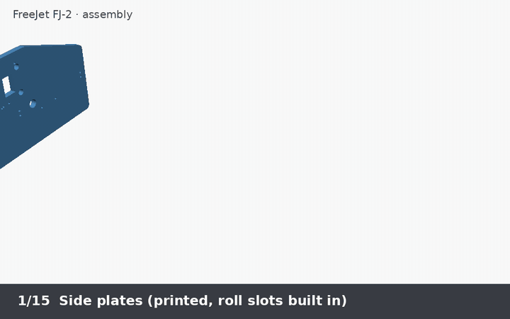

# 4. Assembly

Coordinates used below: **X** = left–right (carriage travel), **Y** =
paper travel (rear → front), **Z** = up. "Inner face" = the side of a plate
that faces the other plate. Tools: 2.5/1.5 mm hex keys, small pliers, a
soldering iron, a multimeter.

## 1. Frame

1. Press a 608 bearing into each of the four bearing pockets (they open on
   the inner faces).
2. Press the three LM8UU into the carriage's closed housings (two on top,
   one below) and snug each clamp screw (M3x16 + nut) until the bearing
   can't rotate in its housing. Don't overtighten: the bearing must still
   slide freely on the rod.
3. Slide the two **carriage rails** through the left plate, through the
   carriage's bearings, then into the right plate.
4. Bolt the three **platen segments** together (3× M3x16 + nuts per joint;
   segment 1 with the paper guide on the left), then bolt the beam's end
   flanges to the inner faces of both plates (4× M3x16 + nuts per side,
   through the vertical slots, leave them finger-tight for now). The beam
   sets the plate spacing (360 mm) and squares the frame.
5. Put a printed **rod collar** on each rail end against the outside of the
   plates and tighten (M3x16 + nut).

## 2. Paper drive

1. Slide hubs onto the two **drive shafts** at the roller positions
   (X = 90, 145, 215, 270 mm from the left plate's inner face; mark the
   rods first). Stretch a TPU tire over each hub. Lock the hubs with M3x8
   set screws.
2. Push each drive shaft through the 608 bearings so 20 mm sticks out on the
   **right**. Collar both ends with printed collars.
3. Mount a 76T printed pulley on each shaft's right end.
4. Mount the feed motor on the **inside** of the right plate (shaft
   through the large slotted hole), 20T pulley outside, aligned with the 76T
   pulleys. Fit the 400 mm closed belt around all three and slide the motor
   down in its slots to tension it, then tighten.
5. **Pinch shaft:** hubs + tires at the same X as the input rollers. Drop
   it into the vertical slots above the input drive shaft, collar both ends
   outside the plates. Hook a small extension spring from each shaft end to
   the M3 screw behind and below the slot, so the tires press the paper onto
   the driven rollers.
6. **Star shaft:** four star wheels (loose, they must spin) on a rod in the
   front slots, sitting on the output rollers by their own weight. Printed
   collars keep it from sliding sideways.

## 3. Platen and paper sensor

1. Screw a KW11-3Z switch to the **sensor bracket** and bolt the bracket to
   the back of the platen's rear web under the slot (2× M3x12 + nuts). The
   lever should poke ~1.5 mm above the ribs; a sheet sliding over it must
   press it down easily.

## 4. Carriage drive

1. Bolt the **X motor bracket** to the outside of the left plate, motor
   hanging under the shelf, shaft up, 20T pulley at belt height.
2. Bolt the **X idler bracket** to the outside of the right plate, idler on
   an M5 × 30 bolt.
3. Run the GT2 belt through the plate windows: the **front** strand belongs
   to the carriage. Push each belt end, teeth facing the printed teeth, into
   the carriage's belt slot from its own side until it shows in the centre
   window; the teeth lock it. The **rear** strand runs free behind the
   carriage. Tension by sliding the motor in its slots: the belt should
   "twang" but not be piano-wire tight.

## 5. Service station

1. Press the printed TPU **cap** into the sled's recess, lip up.
2. Put a KW11 switch (lever up) into the pocket under the sled channel; its
   wires leave through the channel at the plate.
3. Drop the sled into its channel and hook a small extension spring from the
   sled hook to the base's hook post. Pushing the sled's post to the left
   must make the cap rise, releasing it must let it fall back.
4. Clamp the printed TPU **wiper** in the wiper slot (M3 clamp screw) so it
   stands ~0.5 mm above the cartridge's nozzle plate height.
5. Screw the station to the inner face of the left plate (2× M3).

## 6. Electronics

1. Build the main board on perfboard (see `03-electronics.md`), set the
   MP1584 to 5.0 V first, set the TMC2209 currents.
2. Screw it into the electronics tray and bolt the tray under the platen
   beam (4× M3x12 + nuts through the two webs), connectors facing the rear.
3. Wire the motors, the home switch, the paper switch, the button and the
   LED. Route the 16-way ribbon from the tray up to a strain relief at the
   back of the left plate, then in a gentle loop to the top of the carriage
   (it must not touch the rails at either end of travel).
4. Fit the printhead board in the carriage's rear pocket (pads facing
   forward, into the cartridge pocket) with four M2.5 screws.

## 7. Trays

* Sheet tray: screw the two tray brackets to the rear holes of the plates
  and lay the two joined tray halves on them; fixed edge on the left.
* Roll holder (instead of the tray): screw on the two roll arms, put the
  roll on an 8 mm rod between the two printed cones, rod into the hooks.

## 8. Cartridge

1. Remove the tape from the nozzles and the contacts. Don't touch either.
2. Drop it into the carriage, contacts facing back. Put the pressure pad in
   front of it and tighten the thumbscrew until the cartridge sits firmly
   against the contact pads (snug, not crushing).
3. Check the gap: a stack of 12 sheets of 80 g/m² paper (≈ 1.2 mm) should
   just slide between the nozzle plate and the platen ribs. Adjust by
   sliding the platen's end flanges up/down in their slots, then tighten.

Then continue with [the bring-up and calibration](08-calibration.md).
