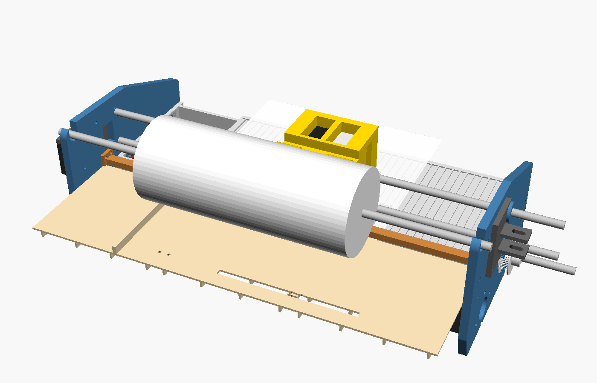

# 12. Grayscale and colour



FJ-2 uses the same cartridges as Openprinter: the **HP 63/302 black** and the
**HP 63/302 tri-colour** (cyan, magenta and yellow in one cartridge). Fit one
or both:

| Ink set | Cartridges (left → right) | What you get | `--inks` |
|---|---|---|---|
| K | black | text, line art, halftoned grey | `K` |
| CMY | tri-colour | colour; black is mixed from C+M+Y (brownish, 3× the ink) | `CMY` |
| KCMY | black, tri-colour | **full colour with real black text** | `KCMY` |

## Grayscale

Every build prints grayscale: the driver halftones grey into black dots. To
make it as good as it can be:

* `--dither fs` (error diffusion) for photos; `auto` (default) keeps text
  crisp and dithers only real mid-tones.
* `--gamma 1.25` (or *Tone: Lighter* in the print dialog) if photos come out
  too dark. Ink dots spread on paper ("dot gain"), so mid-greys print darker
  than on screen. Try `1.0`, `1.25` and `1.5` and keep the best.
* Use smooth, coated inkjet paper for photos.

## Colour

The driver converts each pixel from RGB to cyan/magenta/yellow. With KCMY it
takes the grey part out and prints it with black (so black text and neutral
greys use only the black cartridge), and limits the total ink to 260 % so the
paper doesn't soak through. Each ink is halftoned separately.

The colour cartridge's nozzles are 1/300" apart (84 per colour), so colour is
printed at 600 × 300 dpi, black at 600 × 600 dpi. In a KCMY pass the black
cartridge uses the 168 rows that line up with the colour nozzles
(`k_dy_rows`), so a colour pass is 7.1 mm tall; black-only pages still use all
324 black rows (13.7 mm).

## Hardware

* **Black only or colour only:** the standard build (`make -C cad -j8`,
  STLs in `cad/stl/`, 400 mm rods). A tri-colour cartridge goes in the same
  pocket as a black one.
* **Black + colour:** build the two-pocket version:

  ```bash
  make -C cad -j8 CARTS=KCMY       # STLs in cad/stl-kcmy/
  ```

  The carriage gets a second pocket 28 mm to the right; the frame gets 56 mm
  wider (every cartridge has to cross the whole page): 416 mm inner width,
  500 mm rods, ≈ 48 cm outside. The service station gets a second cap.
* **Electronics:** nothing extra to build. The main board already has the
  heater switches for both cartridges (F3/F5 black on GP16/17, colour on
  GP18/19); the second contact flex is wired in parallel except for F3/F5
  (see [`03-electronics.md`](03-electronics.md)).

## Ink

The cartridges come full. To refill them, use **dye refill ink made for HP
thermal cartridges** (sold for HP 63/302/65/67, ~$10 for 4 × 100 ml).
Thermal heads need ink formulated for boiling in microseconds. **Don't** use
Epson/piezo inks, fountain-pen or drawing inks: they burn onto the heaters or
clog.

Refilling: peel the label, push a blunt needle into the fill hole of each
chamber (the tri-colour cartridge has three, check which is which by the
colour on the needle tip), fill slowly until it stops taking ink, wipe the
nozzles, then `freejet clean`. HP's ink-level warnings don't apply here: the
FreeJet firmware doesn't read the cartridge's chip.

## Software

```bash
freejet setup --inks KCMY            # cartridges fitted + frame geometry
freejet test nozzles --inks KCMY     # nozzle check for both cartridges
freejet test colors --inks KCMY      # line the cartridges up (see 08-calibration.md)
freejet print photo.jpg --inks KCMY --dither fs
freejet preview photo.jpg --inks KCMY -o sim.png   # simulated print in colour
```

In CUPS choose *Color Mode: Color* and the cartridges fitted (set them once
as defaults: `lpadmin -p FreeJet -o ColorModel=RGB -o FJInkSet=KCMY`). A job
whose ink set doesn't match the printer's `cartridges` setting is refused
with a clear error.

## Status

The colour pipeline (separation, halftoning, multi-plane protocol, firmware
composer for black + colour with X/Y offsets, the waveform for both
cartridges) is implemented and tested in software, including K, CMY and KCMY
jobs run through the firmware's C code and a colour PDF through real CUPS.
Like the rest of the printer it hasn't run on hardware yet. The colour
offsets (`color_x_um`, `cmy_pitch_um`, `k_dy_rows`) are estimates until
someone measures a real cartridge; `freejet test colors` finds them.
