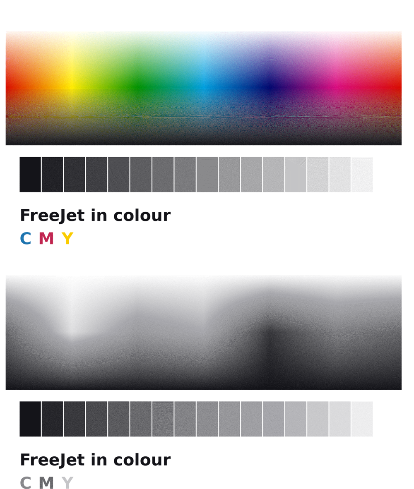

# 12. Grayscale and colour




*Simulated prints from `freejet preview --inks CMYK` / `--inks KLK`: the real driver output, drawn with approximate ink colours.*

## The idea

An HP45 is just a thermal printhead with an ink tank on top. It doesn't
know or care what colour the ink is: the same 300 nozzles fire whatever
water-based ink is inside. So instead of reverse-engineering a different
(chipped, undocumented) colour cartridge, FreeJet uses **more HP45-format
cartridges, each filled with a different ink**, side by side in a wider
carriage. One firmware, one head board design, one cartridge type.

| Ink set | Cartridges (left → right) | What you get | `--inks` |
|---|---|---|---|
| K | black | text, line art, halftoned grey (the basic printer) | `K` |
| KLK | black, light black | **smooth grayscale**: photos and grey fills without visible dots | `KLK` |
| CMY | cyan, magenta, yellow | colour; black is mixed from all three (brownish, uses 3× ink) | `CMY` |
| CMYK | black, cyan, magenta, yellow | **full colour** with real black text | `CMYK` |

## Grayscale without extra hardware

The 1-cartridge printer already prints grey: the driver halftones every
grey into a pattern of black dots (error diffusion). To make that as good
as it can be:

* `--dither fs` (error diffusion) for photos, `auto` (default) keeps text
  crisp and dithers only real mid-tones.
* `--gamma 1.25` (or *Tone: Lighter* in the print dialog) if photos come
  out too dark. Ink dots spread on paper ("dot gain"), so mid-greys print
  darker than on screen. Print the same photo with `--gamma 1.0`, `1.25`
  and `1.5` and keep the one that looks right.
* Use smoother, coated inkjet paper for photos.

## Smooth grayscale: black + light black (KLK)

A second cartridge filled with **light black** (diluted black, about a
third as dark) prints the light and mid greys. Light dots are much less
visible than sparse black ones, so the image looks smooth, the way photo
printers do it. The driver splits every grey between the two inks
(light black alone up to ~30 % grey, black taking over in the shadows).

## Colour: CMYK

The driver converts each pixel from RGB to cyan/magenta/yellow, takes the
grey part out and prints it with black (so black text uses only the black
cartridge and neutral greys stay neutral), limits the total ink to 260 % so
paper doesn't soak through, and halftones each ink separately.

## Hardware for 2–4 cartridges

* **Frame and carriage:** build the CAD with the cartridge count:
  `make -C cad -j8 N_HEADS=4` (or 2, 3) writes the STLs to `cad/stl-4heads/`.
  The carriage gets one pocket per cartridge (28 mm apart); the frame gets
  56 mm wider per extra cartridge, because every cartridge has to cross the
  whole page:

  | Cartridges | Frame inner width | Rods | Outside width |
  |---|---|---|---|
  | 1 | 360 mm | 6 × 400 mm | ≈ 42 cm |
  | 2 | 416 mm | 6 × 500 mm | ≈ 48 cm |
  | 3 | 472 mm | 6 × 600 mm (cut to 520) | ≈ 53 cm |
  | 4 | 528 mm | 6 × 600 mm (cut to 580) | ≈ 59 cm |

  The service station gets one cap per cartridge; the firmware moves each
  cartridge over the single spittoon in turn.
* **Electronics:** one printhead board per cartridge (the same narrow board),
  each with its own ribbon cable. The main board gets one 2×8 header per
  slot; on header *h*, pin 9 (`P_SER`) goes to GP16+*h* and pin 16 (TSR) to
  input *h* of a 74HC4051 multiplexer. Every other pin is wired in parallel.
  All cartridges share the address lines, clocks and fire pulse; the Pico's
  PIO shifts the four data lines at the same time, so four cartridges fire
  as fast as one. See [`03-electronics.md`](03-electronics.md).
* **Power:** the 12 V / 5 A brick is enough: the cartridges only draw high
  current for microseconds and each head board has its own 940 µF.
* **Extra cost:** about $9 per extra cartridge slot (head board + chips +
  ribbon), plus $3–6 of longer rods and belt, plus the cartridges and ink.

## Ink

**Cartridges.** Either buy new HP45 (51645A) cartridges and swap the ink, or buy
*empty refillable* HP45-format ("TIJ 2.5", "12.7 mm") cartridges; those are sold
for handheld date coders. Make sure they are for **water-based** ink.
Solvent cartridges for coders (MEK) are not suitable.

**Emptying a new HP45 for another colour:** remove the label over the fill
hole, draw the black ink out with a blunt syringe, then flush 4–5 times
with distilled water (fill, spit/prime with `freejet clean`, draw out)
until it runs clear, and once with the new ink. Expect the first few pages
to be slightly tinted.

**Which ink.** Use **dye refill ink made for HP thermal cartridges** (sold
for HP 63/302/65/67 refilling, ~$10 for 4 × 100 ml). Thermal heads need ink
formulated for boiling in microseconds. **Don't** use Epson/piezo inks,
pigment ink for piezo printers, fountain-pen or drawing inks; they kogate
(burn onto the heaters) or clog.

**Light black.** Use a ready-made photo-grey/light-black refill ink for HP
thermal printers if you can get it. Otherwise dilute your black refill ink
about 1:3 with the same maker's colourless ink base/"diluent", **not with
plain water**: water changes the surface tension and the drops misfire.
Mixing light black is the most experimental part of this; start with the
CMYK or K set if you want a sure thing.

**Refilling:** fill slowly through the fill hole until a bead of ink shows
on the nozzles, wipe, then `freejet clean`. Mark each cartridge with its
slot. Put them in the carriage in the ink set's order (slot 0 = left).

## Software

```bash
freejet setup --inks CMYK          # sets n_heads and the frame geometry for the standard build
freejet test nozzles --inks CMYK   # one nozzle check per cartridge
freejet test heads --inks CMYK     # line the cartridges up (below)
freejet print photo.jpg --inks CMYK --dither fs
freejet print photo.jpg --inks KLK --dither fs --gamma 1.2
freejet preview photo.jpg --inks CMYK -o sim.png   # simulated print in colour
```

In CUPS choose *Color Mode: Color* and *Cartridges fitted: 4 cartridges -
Black, Cyan, Magenta, Yellow* (set them once as defaults:
`lpadmin -p FreeJet -o ColorModel=RGB -o FJInkSet=CMYK`). A job whose ink
set doesn't match the printer's `n_heads` is refused with a clear error.

## Lining the cartridges up

Each extra cartridge sits ~28 mm to the right of slot 0, but a few tenths
of a mm off is visible as colour fringes, so it gets calibrated:

```bash
freejet test heads --inks CMYK
freejet calibrate head-x 1 -2     # slot 1: the block where its lines merge with slot 0's
freejet calibrate head-y 1 1      # slot 1: the block where the dashes form one line
# ... same for slots 2 and 3
```

Sideways (X) is corrected in firmware by timing. Vertically (Y) each
cartridge has 6 spare nozzles at each end: with 2+ cartridges a pass uses
288 of the 300 nozzles, and `headN_dy_rows` picks which 288, so vertical
misalignment up to ±6/600" (±0.25 mm) is corrected without moving anything.

## Status

The colour pipeline (separation, halftoning, multi-plane protocol, firmware
composer for 4 cartridges with X/Y offsets) is implemented and tested in
software, including CMYK, KLK and CMY jobs run through the firmware's C
code and a colour PDF through real CUPS. Like the rest of the printer it
hasn't run on hardware yet. Ink behaviour (especially home-mixed light black)
needs real tests.
